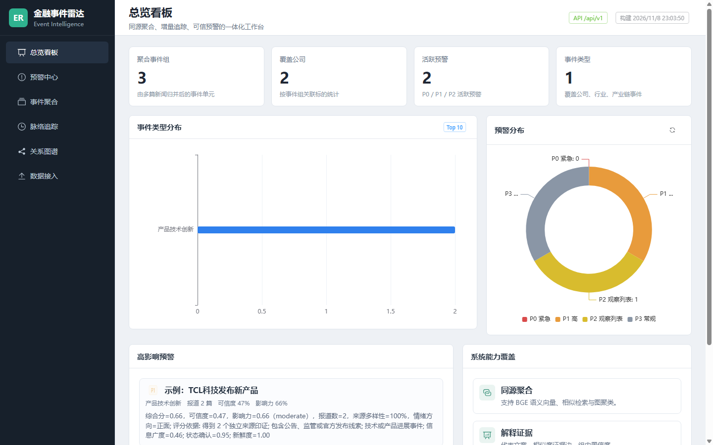

# 金融事件雷达

**上市公司事件识别、聚类与智能预警系统**，面向公司与行业新闻的分析和展示。系统将多篇报道归并为事件组，呈现事件时间线、关联图谱与预警信息，并支持后续事件接入。



上图仅展示虚构样例的处理结果。

## 项目功能

- **事件识别**：抽取事件类型、主体、时间与影响方向，支持兼容 OpenAI API 的模型服务以及规则回退。
- **同源聚合**：结合 BGE 中文文本向量、近邻检索与相似度图聚类；未归入多篇报道组的文章保留为单例。
- **评分与预警**：利用文本分类、来源、事件要素和报道情况生成可解释的可信度、影响评分及 P0–P3 预警等级。
- **交互展示**：总览、事件列表、预警中心、时间线、关系图谱，以及结构化或自然语言事件接入。
- **增量归组**：轻量模式通过字符 n-gram TF-IDF 检索已有事件组；准备好 BGE 模型和事件组向量索引后，可使用语义归组。

```text
新闻 → 事件要素抽取 → 文本向量与相似检索 → 事件聚类
     → 分类及规则评分 → 分级预警 → API / 时间线 / 图谱 / 看板
                                    ↑
                            新事件增量接入
```

**技术栈**：Python、FastAPI、NumPy、scikit-learn、Sentence Transformers、FAISS、Vue 3、TypeScript、Element Plus、ECharts。

## 实验记录

在已有的公司新闻实验记录中，654 篇转载检索原文的 Recall@1 为 **97.7%**；原文与转载共 2,524 篇的图聚类实验中，阈值 0.94 下 purity 为 **0.964**、ARI 为 **0.791**，组检测率为 **97.6%**。数据规模、标签口径与方法见 [实验报告](docs/BASELINE_REPORT.md)。这些是特定数据集上的历史实验结果，不代表对新数据的性能保证。

## 运行示例

以下流程使用仓库内的 **5 条虚构新闻**、规则抽取和 TF-IDF，不需要大模型或真实新闻数据。建议使用 Python 3.11/3.12 和 Node.js 20+。

```bash
# 在项目根目录创建并启用 Python 虚拟环境后执行
python -m pip install -r requirements-demo.txt

# 抽取示例新闻；--rule-only 确保不会调用外部模型服务
python -m src.event_ner.run --input examples/news.json --output data/extracted/example.json --rule-only

# 聚类、评分与生成预警（示例不加载标注训练集）
python -X utf8 scripts/pipeline_end_to_end.py --source events --input data/extracted/example.json --embedding-backend tfidf --no-classifier
```

以上命令会覆盖 `data/extracted/example.json` 和 `data/results/` 中同名结果文件。如果 `data/web/` 已存在另一批轻量结果，API 会优先读取它们；要展示刚生成的结果，可先备份原有文件，再执行 `python -X utf8 scripts/export_web_results.py`，该命令会覆盖对应的轻量结果文件。虚构样例仅用于检查流程，不能用于评估模型效果。

安装并构建前端，然后启动后端：

```bash
cd frontend
npm ci
npm run build
cd ..
python -m uvicorn src.api.main:app --host 127.0.0.1 --port 8000
```

打开 `http://127.0.0.1:8000`；接口文档位于 `http://127.0.0.1:8000/docs`。增量索引在后台构建，接入页面显示就绪后即可尝试提交。开发时也可在 `frontend/` 执行 `npm run dev`，通过 `http://localhost:5173` 访问。

## 数据与完整模型

仓库仅包含虚构样例和事件类型文件，不包含原始新闻、预计算展示数据、训练数据或模型权重。完整跑批需安装 `requirements.txt`，自行准备有使用权的数据、标注训练集和 BGE 模型；`--no-classifier` 仅跳过分类器，保留抽取类型并执行规则评分。原有预计算结果可放在本地 `data/web/`，相关文件不会提交到仓库。

自然语言接入可选配置 `.env`（参见 `.env.example`）或在界面填写兼容接口的地址、模型和密钥；使用外部服务时新闻文本会发送至所选服务。未配置密钥时跳过大模型初评。缺少 BGE 模型或事件组向量索引时，接入使用轻量 TF-IDF 路径，分类结果可能为空。批量抽取模块另支持 `LLM_API_KEY`、`LLM_PROVIDER`、`LLM_BASE_URL` 和 `LLM_MODEL` 环境变量。

## 测试

```bash
python -m pip install pytest
python -m pytest -q
# 服务运行后执行只读接口检查；需要已有事件数据和前端构建产物
python -X utf8 scripts/smoke_test_api.py
```

加 `--include-ingest` 可检查事件接入，该选项会写入测试记录；请在隔离数据目录运行。预警是辅助分析结果，评分和阈值需要针对目标数据验证，不能替代人工核查。

## 目录

| 路径 | 内容 |
| --- | --- |
| `src/event_ner/` | 事件抽取与标准化 |
| `src/clustering/`、`src/features/` | 向量化、检索与聚类 |
| `src/services/` | 事件归组、分类、评分、预警与增量接入 |
| `src/api/`、`frontend/` | API 与可视化界面 |
| `scripts/`、`tests/` | 流水线、评估、索引和测试 |
| `examples/`、`docs/`、`docker/` | 虚构样例、实验记录和容器配置 |

项目整理自 [原始项目仓库](https://github.com/2483039833/huatai)，并参考本地展示版完善。
